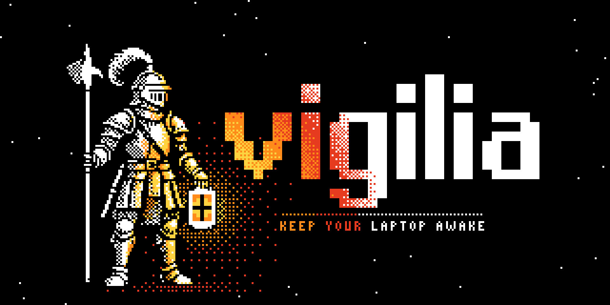

<p align="center"></p>

Keep your laptop awake for a set time, from the terminal or from a coding agent, and pay almost nothing in battery for it.

```sh
vigilia start 2h             # keep the Mac awake for 2 hours
vigilia start                # keep it awake until `vigilia stop`
vigilia status --watch       # live countdown; Ctrl-C to quit
vigilia extend 30m           # add 30 minutes to the running session
vigilia stop                 # end it now and let the Mac sleep again

vigilia start 3h --extend    # in scripts and agents: start a session, or make the running one last at least 3h
vigilia start 4h --lid       # also stay awake with the lid closed (needs `vigilia install` first)
vigilia status --json        # the session as JSON, for scripts
```
For more details, see the [CLI documentation](docs/cli.md).

## Install

There are no prebuilt binaries yet, so you install the CLI from [crates.io](https://crates.io/crates/vigilia). It needs macOS and [rustup](https://rustup.rs).

```sh
cargo install vigilia --locked
```

To build from source instead:

```sh
git clone https://github.com/marti-jorda-roca/vigilia.git
cd vigilia
cargo install --path crates/cli --locked
```

This puts a single `vigilia` binary in `~/.cargo/bin`. Make sure that directory is on your `PATH`.

For lid-closed sessions, run `vigilia install` once: it shows a narrow sudoers rule (only `pmset disablesleep 1/0`) and asks before installing it, along with the socket-activated service LaunchAgent and a run-once-at-login `vigilia recover` job. `vigilia uninstall` removes them.

## Layout

| Crate | What it holds |
|---|---|
| `crates/protocol` | Wire types (requests, responses, events), `ClientContext` and scopes, the generated JSON Schema |
| `crates/core` | Session state machine, recovery journal, battery/heat rules, config, paths. No OS code |
| `crates/platform` | `Platform` trait and `Capabilities`; macOS backend (idle-sleep assertion, `pmset disablesleep`, IOKit lid/power events, launchd backstop, GCD deadline timer), stubs for Linux and Windows, `FakePlatform` for tests |
| `crates/daemon` | The service: dispatch with scope checks, event bus, owner-only Unix socket, instance lock, launchd socket activation, idle exit |
| `crates/cli` | The `vigilia` binary: client commands that start the service when it isn't running, and `vigilia daemon`, the service itself |

## Development

```sh
cargo test --workspace
```

### Releasing

Publishing a [GitHub Release](https://github.com/marti-jorda-roca/vigilia/releases) publishes every workspace crate to crates.io via [`.github/workflows/release.yml`](.github/workflows/release.yml), in dependency order (`vigilia-protocol`, `vigilia-core`, `vigilia-platform`, `vigilia-daemon`, then `vigilia`). Tag the release `vX.Y.Z`, matching `version` in the root `Cargo.toml`; the workflow refuses to publish when the tag and version differ, and skips versions that are already published, so a failed release can simply be re-run.

One-time setup before the first release:

1. Create an API token at [crates.io/me](https://crates.io/me) with the *Publish new crates* and *Publish updates to existing crates* scopes.
2. Add it to this repository as the secret `CARGO_REGISTRY_TOKEN` (Settings → Secrets and variables → Actions).

After the first release you can replace the token with [crates.io Trusted Publishing](https://crates.io/docs/trusted-publishing) if you prefer short-lived credentials.

### Lint and format

CI runs these two checks and fails on any warning, so run them before you push:

```sh
cargo fmt --all --check
cargo clippy --workspace --all-targets -- -D warnings
```

To run both on every commit, install [pre-commit](https://pre-commit.com) (`brew install pre-commit`, or [prek](https://github.com/j178/prek)) and enable the hooks once per clone:

```sh
pre-commit install
pre-commit run --all-files   # optional: check the whole tree now
```

`cargo fmt --all` rewrites the files in place. Clippy can fix some warnings for you with `cargo clippy --fix --workspace --all-targets --allow-dirty`.

The macOS code is only compiled on macOS. To check the other platforms from a Mac, add their targets once with `rustup target add x86_64-unknown-linux-gnu x86_64-pc-windows-msvc`, then pass `--target` to clippy:

```sh
cargo clippy --workspace --all-targets --target x86_64-unknown-linux-gnu -- -D warnings
```

The protocol's JSON Schema in `crates/protocol/schema/protocol.schema.json` is generated from the Rust types, and a test fails when it is stale. After changing protocol types:

```sh
UPDATE_SCHEMA=1 cargo test -p vigilia-protocol --test schema
```

Protocol changes may only add things (new methods, events, optional fields). From v0.1 on, CI will also compare the schema against the previous release's.

## License

Apache-2.0. See [`LICENSE`](LICENSE).
